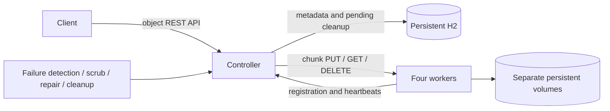

# Full-system build, demonstration, and architecture

This runbook describes the Java 21 / Spring Boot 4.1.2 project with one controller and four workers. The controller runs on port 8081. Worker host ports are 8082-8085; every worker listens on 8082 inside Docker. The client can be PowerShell/curl on the host.

## Build and start

From the project root, stop any manually started controller or worker terminals that occupy ports 8081-8085. Keep the existing source files and tests; the completion files are additions or full replacements of the specifically listed files.

```powershell
$env:JAVA_HOME = 'C:\Program Files\JetBrains\PyCharm 2024.3.1.1\jbr'
.\mvnw.cmd clean test
docker compose config
docker compose up --build -d
docker compose ps
curl.exe -s http://localhost:8081/internal/status
```

Run the Docker command only after the Maven tests pass. Docker Desktop must be running in Linux-container mode. The first build downloads Maven dependencies and base images. Docker builds skip test execution because the preceding host command runs the full suite.

Wait until `/internal/status` shows four ALIVE workers before uploading. Workers retry registration after the controller becomes ready; `depends_on` alone does not establish application readiness. [Docker startup-order documentation](https://docs.docker.com/compose/how-tos/startup-order/).

```powershell
.\docs\demo-B.ps1
```

The script creates a new disposable binary object, intentionally corrupts one of its stored copies, stops/restarts a worker, and restarts the controller. It checks hashes and physical inventories, then deletes its test object. It saves JSON snapshots, original/downloaded test files, and controller logs under `data/demo-B-<uuid>`. It does not delete other objects or remove Docker volumes.

If local script execution is blocked by PowerShell policy, read the script and execute its commands manually, or use the execution method permitted by your machine's policy.

```powershell
docker compose logs --tail 100 controller
docker compose logs --tail 100 worker2
docker stop worker2
docker start worker2
docker compose down
```

`docker compose down` keeps the named volumes. Do not use `down -v` when demonstrating persistence: it removes the stored data. Each worker keeps its own volume, identity, and advertised address. Do not swap volumes between worker identities.

## Assignment coverage

| Assignment section | Implementation / demonstration |
| --- | --- |
| 1, 3: arbitrary objects and metadata | Person A's client APIs; binary upload and SHA-256 round trip; metadata PATCH without re-upload |
| 2, 9: one controller, four persistent workers, Docker | `compose.yaml`, `Dockerfile`, five named volumes; host client |
| 4: 1 MiB chunks, ordering, two distinct copies | Existing upload placement; recovery manager; demo uses 3 MiB + 17 bytes |
| 5: client REST APIs and errors | Existing API routes retained; deletion completes with 204, missing object returns 404, unavailable storage returns 503 |
| 6: registration, heartbeat, PUT/GET/DELETE, inventory | Existing routes retained; heartbeat route and worker lifecycle added |
| 7: worker failure and recovery | 5-second heartbeat, 20-second timeout, 2-second detector; stop/start an actual holder and verify downloads and repaired copies |
| 8: integrity and recovery | Worker checksum verification, controller verification, periodic scrub/repair; intentionally damage a stored replica |
| 10: required demonstration | `demo-B.ps1` and saved before/during/after evidence |

## Architecture decisions and tradeoffs



| Decision | Reason and cost |
| --- | --- |
| One controller with a persistent H2 database | Matches the assignment and avoids a consensus service. The controller remains a single point of availability; preserving its database is required. |
| Keep Person A's entities, DTO fields, client routes, placement API, and `fetchVerified(Chunk)` signature | Maintains the integration contract. Registration adds a response header; heartbeat uses that header without changing the shared DTO. |
| Workers use fixed IDs, URLs, and volumes | Gives every cleanup request a stable storage destination. Arbitrary address reassignment and volume swapping are outside the deployment model. |
| Two verified replicas on different workers | A single worker failure still leaves a readable copy. Repair requires at least one good source and an available destination. |
| Placement uses recorded replicas and active write reservations | New assignments immediately influence subsequent upload and repair placement. Heartbeat counts remain a conservative floor for physical data not yet recorded. Selection and reservation are synchronized in the single controller; worker HTTP calls run outside that lock. |
| Registration precedes ALIVE status | Files are checked before old location records are trusted. A heartbeat cannot make a DEAD or REGISTERING worker ALIVE. |
| Heartbeat registration token | A stale worker heartbeat is rejected with 409. The worker obtains a fresh token through registration. This is a concurrency guard, not authentication. |
| 5 s heartbeat / 20 s timeout | Tolerates several missed heartbeats. Failures are detected after about 20-22 s in an idle small cluster, not instantly. Network delays can cause false suspicion. |
| Periodic full scrub and repair | Simple and sufficient for the four-worker project. Scanning every known copy costs I/O and is not a scalable production index. A pass starts again 10 s after the previous pass ends. |
| Short database transactions around HTTP work | Worker timeouts do not hold database locks. Current worker tokens and object state are checked when metadata changes are committed. |
| Persistent write intents | Record possible copies before PUT, including requests with lost responses. They are retained for the object's lifetime so final deletion includes uncertain copies. With four fixed workers there is at most one intent per chunk/worker pair. |
| Durable deletion jobs | A crash or offline worker leaves recoverable cleanup work. Jobs use bounded exponential retry delays of 5 s through 300 s. |
| Two-stage object deletion | Mark DELETING and queue jobs atomically; hide the object from downloads/listing; delete metadata after all known copies acknowledge deletion. Return 503 while pending, 204 when completed, and 404 after it is gone. Metadata GET exposes DELETING while pending. |
| Separate retirement and replica eviction | Normal chunk DELETE creates a persistent marker blocking late PUTs. `DELETE ...?retire=false` removes an excess copy without retiring the ID, so it can be a repair target later. |
| Atomic replacement of a corrupt replica | Verified PUT can replace a record that fails its own integrity check. Healthy conflicting bytes still return 409; deleted IDs remain blocked. Atomic move must be supported by the volume. |
| Download preflight verifies bytes | Detects unavailable/corrupt chunks before committing a successful response where possible. It adds a second read during streaming; memory stays bounded by chunk size. |

Controller scheduling is opt-in through `OBJECTSTORE_MAINTENANCE_ENABLED=true` (set by Compose). Tests and the fake profile remain deterministic by leaving it disabled. The scheduler has three threads so slow repair/cleanup cannot prevent heartbeat timeout checks. [Spring scheduling documentation](https://docs.spring.io/spring-framework/docs/current/javadoc-api/org/springframework/scheduling/annotation/EnableScheduling.html).

## Failure behavior

| Failure | Expected behavior |
| --- | --- |
| Worker stops | Reads try another replica immediately; detector later marks it DEAD and repair restores two copies where possible. |
| Worker restarts | Its volume is retained. It registers, inventories and verifies files, then becomes ALIVE. Excess valid copies are reduced to two. |
| Controller starts before workers, or workers start before controller is ready | Worker lifecycle retries registration. No fixed startup sleep is relied on for correctness. |
| Controller restarts with database intact | Workers start as DEAD and re-register. Incomplete uploads are cleaned up; pending deletions resume. |
| PUT writes bytes but its response is lost | Intent remains. Failed upload cleanup queues deletion; a successful object's maintenance pass discovers the possible extra copy and reconciles it. |
| Crash during a staged chunk write | Partial `.tmp` data is not published and is removed on worker startup. |
| Chunk bytes are corrupted | Worker GET returns 409; controller flags that replica and uses a valid copy. Scrub/repair restores it when a good source exists. |
| Missing chunk file | Controller tries another location and removes the stale replica record; maintenance repairs the shortage. |
| Every copy is lost or corrupt | Return unavailable; do not invent data or claim successful repair. A backup would be required. |
| Registration changes during a write or deletion | Token/state checks reject stale metadata publication or job acknowledgement. Retry later. |
| Object deletion races with repair/upload | DELETING blocks new publication. Previously recorded intents become deletion jobs; worker markers reject delayed writes. |
| Worker unavailable during object DELETE | Object becomes inaccessible; return 503 and retain cleanup state. Returning worker can register even with DELETING chunks, allowing cleanup to complete. |
| Controller crashes after worker DELETE but before acknowledging the job | The durable job repeats an idempotent DELETE. |
| Failure after a download has already begun streaming | The connection may end with a partial response. A status already sent cannot be replaced; clients must reject incomplete data/checksum mismatch and retry. |

The assignment does not require controller high availability, authentication/TLS, quotas, deduplication, cross-region operation, or recovery after losing the controller database. This deployment uses a trusted local Docker network and exposes host ports on loopback only. Persistent volumes cover container stop/start and recreation; they are not backups and do not promise survival of disk loss or arbitrary power failure.

Unknown files with no controller metadata or write history are not automatically erased. That is separate administrative recovery, rather than a reason to delete potentially valuable bytes. Deletion markers are retained; no unsafe age-based marker removal is used. The project restores replication after failures but does not rebalance an already healthy two-copy chunk merely to distribute load more evenly.

Placement ranks each ALIVE worker by `max(reported chunk count, distinct recorded replica count)`
plus distinct reserved chunks that do not already have a replica record on that worker.
Counting a committed replica removes the overlapping reservation from the load calculation.
Reservations stay open through metadata commit and close on every normal success or exception
path. Repair replacements also reserve their destination. Retries exclude workers already
attempted for that chunk, and a known corrupt copy is still repaired in place when possible.

Reservations are process-local scheduling information, not durable write evidence. Existing
write intents continue to provide crash recovery and deletion tracking. After restart, metadata
and worker re-registration supply the load baseline. A heartbeat can briefly include a write
that is also reserved but not yet committed; this conservatively overestimates load until commit
or release. Stale high heartbeat counts after deletion can persist until the next heartbeat.
The policy balances chunk count, not bytes or request rate. Under equal initial load, four
chunks with two replicas each spread as two copies per worker; existing unequal load may
correctly cause a new object to favor the less-loaded workers. No database schema change is needed.

## Compatibility with the controller handoff

The public object routes, JSON response fields, shared `common` DTOs, chunk constants,
`PlacementService.pickOneNotIn(Set<String>)`, and `DownloadService.fetchVerified(Chunk)`
remain available with their original contracts. Registration, repair, and cleanup use the
existing controller entities and repositories.

Internal additions include a worker registration token, the `REGISTERING` state, replica
uniqueness enforcement, write-intent/deletion-job tables, and worker-client operations for
inventory, confirmed deletion, and replica eviction. Service constructors now include the
supporting services through Spring dependency injection. These are extensions to the
controller implementation; its original source is not unchanged.

One deliberate client-visible change is offline deletion: it returns 503 while physical
cleanup is pending, then 204 when a request completes deletion or 404 after background
cleanup has already finished. This replaces the handoff's earlier best-effort deletion
description and is documented in `api.md`. Invalid pagination returns 400 using the
existing `ErrorResponse` JSON fields.

## Validation record

Pending deletion is durable: the object becomes `DELETING` and cleanup jobs commit together.
A job is removed only after a worker confirms deletion and its registration still matches.
Retries preserve acknowledged progress and outstanding backoff; a lost response leaves the
job pending. Worker deletion markers reject delayed writes to the retired chunk ID.
After a controller restart with its database intact, workers re-register and the maintenance
runner resumes the remaining jobs. Completion needs the recorded workers to return with
their configured identities, URLs and persistent storage. Backoff can delay cleanup by up to
five minutes, plus processing time. If a worker never returns, deletion stays pending.

`demo-B.ps1` now repeats DELETE and restarts the controller while a holder is still stopped.
It checks 503 and `DELETING` before and after restart, then returns the worker and waits for
automatic completion without another DELETE. It checks every worker's chunk files are gone
before asserting the final 404. The retained `.deleted` markers are intentional.

Run the complete Maven suite after applying all files. Added tests exercise heartbeats, failure repair, corruption recovery, returning-worker reconciliation, permanent data loss, controller restart state, pending deletion, deletion-response loss, stale registration, metadata guards, missing-replica fallback, corrupt-record replacement, and eviction versus retirement.

The tests use real H2 transactions and either the in-memory worker or mocked HTTP boundaries. They do not prove real Docker networking or physical restart behavior. The Docker demonstration provides those integration checks. Record the actual command results and demo evidence before claiming completion.

Useful references: [Docker named volumes](https://docs.docker.com/engine/storage/volumes/), [Spring transaction propagation](https://docs.spring.io/spring-framework/reference/data-access/transaction/declarative/tx-propagation.html), [Java Files atomic moves](https://docs.oracle.com/en/java/javase/21/docs/api/java.base/java/nio/file/Files.html).
